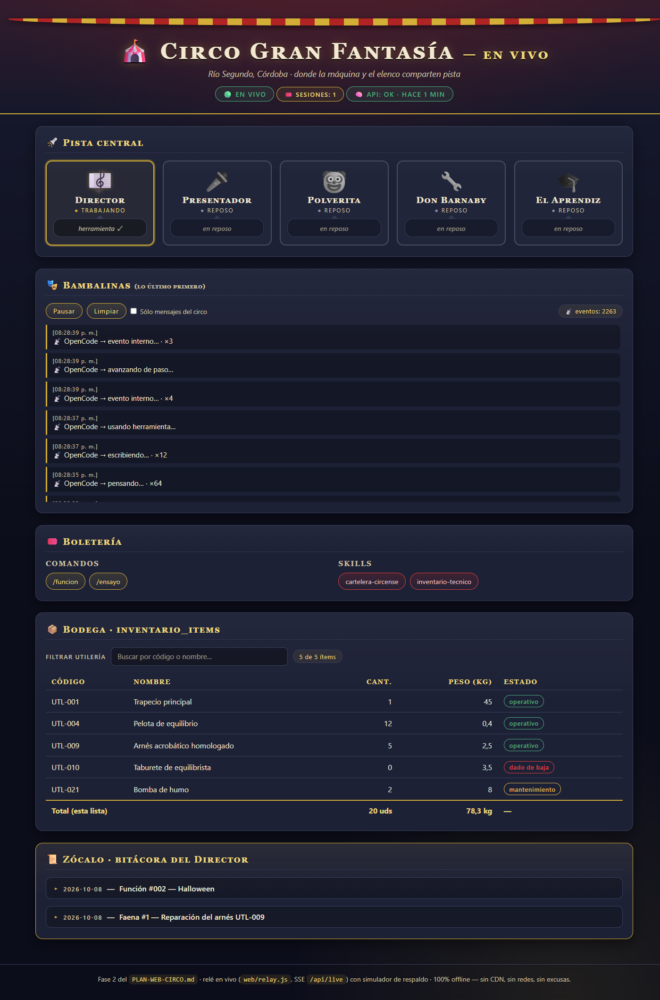

# 🎪 Circo Gran Fantasía

**Un circo ambulante que vive en tu terminal.** Proyecto multi-agente construido sobre [OpenCode](https://opencode.ai), donde un Director de Orquesta coordina a un elenco de agentes temáticos — presentador, payaso, utilero — con bitácora persistente, base de datos Supabase para el inventario y, opcionalmente, un modelo local de inteligencia artificial corriendo en tu propia GPU.

> _"Damas y caballeros, niños y niñas... ¡bienvenidos al espectáculo multi-agente más disparatado del oeste!"_

---

## ✨ Características

- **5 agentes con personalidad y permisos propios:** un Director (agente primario) que orquesta, y subagentes de sólo-lectura para narrativa, más un utilero con escritura controlada.
- **Comandos de función:** `/ensayo` (prueba general del elenco) y `/funcion <temática>` (espectáculo completo que actualiza la bitácora).
- **Skills temáticas:** `cartelera-circense` (cartelera oficial con precios y programa) e `inventario-tecnico` (estructura y reglas del stock).
- **Bitácora persistente `MEMORY.md`:** registro de funciones, ensayos, faenas y decisiones — escritura exclusiva del Director.
- **Inventario en Supabase Postgres:** tabla `inventario_items` con RLS cerrado, checks de integridad, trigger de auditoría y seed de 10 ítems (626,90 kg).
- **🌐 Circo en Vivo (sección web):** dashboard en tiempo real en `http://127.0.0.1:7777` — los eventos de la sesión traducidos del JSON crudo a lenguaje de carpa, con bodega ordenable, boletería clicable e insignia de salud de la API.
- **Opcional — modelo local:** agente "El Aprendiz" corriendo `qwen3.8` vía Ollama en una RTX 3090, con permisos de contención y reglas antibucle.

---

## 🏗️ Arquitectura

```
                        ┌─────────────────────────────┐
                        │   Usuario (público)         │
                        └──────────────┬──────────────┘
                                       │ /funcion · /ensayo · chat
                        ┌──────────────▼──────────────┐
                        │  🎼 Director (agente        │
                        │     primario)               │
                        │  • dirige el elenco         │
                        │  • escribe MEMORY.md        │
                        └───┬──────┬──────┬───────┬───┘
              delega en     │      │      │       │      delega en
        ┌───────────────────┘      │      │       └──────────────────┐
        ▼                          ▼      ▼                          ▼
🎤 Presentador            🤡 Payaso   🔧 Utilero            🎓 El Aprendiz
  (read-only)             (read-only)  • inventario           (modelo local)
                                              │                     │
                                              ▼                     ▼
                                ┌─────────────────────┐   ┌──────────────────┐
                                │  Supabase (MCP)     │   │  Ollama          │
                                │  inventario_items   │   │  qwen3.8 @ 3090  │
                                └─────────────────────┘   └──────────────────┘
```

El relé **`web/relay.js`** refleja los eventos de la sesión en el dashboard _Circo en Vivo_ (`:7777`), y `web/ollama-proxy.js` queda como sonda de diagnóstico para el modelo local.

---

## 📋 Requisitos

| Requisito                                                                       | Obligatorio | Para qué                                           |
| :------------------------------------------------------------------------------ | :---------- | :------------------------------------------------- |
| **[OpenCode](https://opencode.ai) v2**                                          | ✅ Sí       | Ejecutar el circo (TUI + agentes + MCP)            |
| **Docker + [Supabase CLI](https://supabase.com/docs/guides/local-development)** | Recomendado | Base de datos local del inventario (Postgres 17)   |
| **[Ollama](https://ollama.com) + GPU NVIDIA**                                   | Opcional    | Modelo local para el agente "El Aprendiz"          |
| **Node.js 18+**                                                                 | Para la web | Relé del _Circo en Vivo_ (`node web/relay.js`)     |
| Modelo en la nube conectado en OpenCode                                         | ✅ Sí       | El Director y el elenco usan tu proveedor habitual |

> Sin Supabase, el circo funciona pero el Utilero no tendrá inventario. Sin Ollama, no hay El Aprendiz. Sin Node.js, no hay dashboard web. El resto del elenco no los necesita.

---

## 🚀 Puesta en marcha

### 1. Clonar y abrir

```bash
git clone https://github.com/Puchinn/Multi-Agent-Architecture-with-OpenCode-v2.git
cd Multi-Agent-Architecture-with-OpenCode-v2
opencode
```

Instala OpenCode con la guía oficial: `curl -fsSL https://opencode.ai/install | bash` (o `npm i -g opencode-ai`) — detalles en la [documentación CLI](https://opencode.ai/v2/docs/cli).

### 2. Levantar la base de datos (recomendado)

```bash
supabase start        # requiere Docker; levanta API :54321, DB :54322, Studio :54323
supabase db reset     # aplica la migración del inventario + seed de 10 ítems
```

El MCP de Supabase ya viene configurado en `opencode.json` (`http://127.0.0.1:54321/mcp`) — OpenCode lo conectará automáticamente.

**Verificación:** pídele al Director _"consulta el stock de la bodega"_ — Don Barnaby debe reportar **10 ítems y 626,90 kg**.

### 3. (Opcional) Modelo local para El Aprendiz

```bash
ollama serve          # en una terminal
ollama pull qwen3.8   # en otra
```

OpenCode **auto-descubre** Ollama en `127.0.0.1:11434` — no hace falta configurar nada. El modelo aparece como `ollama/qwen3.8:latest`.

**Verificación:** pídele al Director un ensayo del Aprendiz y debe cerrar con su veredicto `✅ HECHO`.

### 4. (Opcional) El Circo en Vivo (sección web)

```bash
node web/relay.js     # relé SSE + dashboard en 127.0.0.1:7777
```

Abre **http://127.0.0.1:7777** y sigue la función en directo — el detalle de la pantalla está más abajo, en _Circo en Vivo_.

---

## 🌐 Circo en Vivo (la sección web)



Un dashboard servido por el relé SSE `web/relay.js` en **`http://127.0.0.1:7777`**, pensado para mirar la función sin tener que leer la terminal:

- **Fichas del elenco:** los 5 agentes con su rol, modo y permisos.
- **Pista Central:** estado del Director (en vivo / ocupado / desconectado) con su insignia de frescura.
- **Bambalinas:** eventos de la sesión **traducidos del JSON crudo a lenguaje de carpa**, con agrupación de ráfagas (`×8`), contador de eventos y controles de **pausa**, **limpiar** y filtro _sólo circo_.
- **Boletería:** horarios y precios **clicables** con su detalle desplegable.
- **Bodega:** el inventario **ordenable** por columnas (▲▼ con `aria-sort`) y su peso total.
- **Zócalo:** bitácora de la sesión con marcas de tiempo (`<details>` + `<time datetime>`).
- **Insignia de salud de la API** (`#salud-api`) y favicon propio: consola del navegador limpia, sin 404.

---

## 🎭 Uso

Abre `opencode` en la raíz del proyecto y prueba:

| Entrada                                    | Qué pasa                                                                                                                                      |
| :----------------------------------------- | :-------------------------------------------------------------------------------------------------------------------------------------------- |
| `/ensayo`                                  | Pase de lista del Presentador → chiste de Polvorita → revisión técnica de Don Barnaby → veredicto del Director en la bitácora                 |
| `/funcion Halloween`                       | Función estelar completa con temática: bienvenida, rutina del payaso, cierre con orquesta y **número de función incrementado en `MEMORY.md`** |
| _"presenta una bienvenida solemne"_        | El Director delega en el Presentador                                                                                                          |
| _"cuenta un chiste"_                       | El Director delega en Polvorita                                                                                                               |
| _"¿cómo vamos de stock?"_                  | Don Barnaby consulta Supabase y entrega el parte de bodega                                                                                    |
| _"haz que el Aprendiz resuma la bitácora"_ | El modelo local trabaja en `borradores/` bajo supervisión                                                                                     |
| `http://127.0.0.1:7777`                    | **Circo en Vivo:** la función en directo — eventos, boletería y bodega ordenable                                                               |

---

## 🤖 Los agentes

| Agente           | Rol                                    | Modo       | Permisos                                                                                                              |
| :--------------- | :------------------------------------- | :--------- | :-------------------------------------------------------------------------------------------------------------------- |
| 🎼 `director`    | Orquestador; escribe `MEMORY.md`       | `primary`  | ✅ `MEMORY.md` · ✅ delegar · ✅ shell acotado (`node -v`, `node web/relay.js*`)                                        |
| 🎤 `presentador` | Maestro de Ceremonias                  | `subagent` | ❌ todo (read-only)                                                                                                   |
| 🤡 `payaso`      | Polvorita, humor y bromas              | `subagent` | ❌ todo (read-only)                                                                                                   |
| 🔧 `utilero`     | Don Barnaby; inventario y logística    | `subagent` | ✅ escritura de utilería · ❌ shell · ❌ delegar                                                                      |
| 🎓 `aprendiz`    | Modelo local (Ollama), tareas acotadas | `subagent` | ✅ edición en `borradores/**` y `web/**` · `steps: 20` · shell acotado a `node --check` · regla 2-3 antibucle          |

---

## 🗄️ El inventario

Tabla **`public.inventario_items`** (Supabase, migración `20261008170011`):

- **Clave real:** `id bigint identity` + `codigo text UNIQUE` con formato `UTL-###`.
- **Integridad:** CHECKs de `categoria` (8 valores), `estado` (3 valores), `cantidad ≥ 0`, `peso_kg ≥ 0`.
- **Auditoría:** `created_at`/`updated_at timestamptz` con trigger automático.
- **Seguridad:** RLS activado **sin políticas públicas** — sólo el servidor escribe/lee.
- **Reglas:** los códigos no se reutilizan; las bajas se marcan (`dado_de_baja`), no se borran; el peso total es `sum(cantidad × peso_kg)` sobre ítems no dados de baja.
- El archivo `inventario.json` de la raíz queda **archivado como legacy** (sólo lectura, fotografía del volcado inicial).

---

## 🧠 Modelo local (opcional)

- **Modelo:** `qwen3.8:latest` (27,3B, Q4_K_M ≈ 17,6 GB VRAM) — servido por Ollama en la RTX 3090.
- **Agente `aprendiz`:** subagente con permisos por defecto denegados, escritura limitada a `borradores/**` y `web/**`, tope duro de `steps: 20`, **shell acotado a `node --check *`** (su único comprobador) y **regla 2-3 antibucle** (máximo 2 intentos por enfoque → cambiar o parar).
- **Protocolo de cierre:** toda respuesta termina con `✅ HECHO` / `⚠️ BLOQUEADO` / `❌ FALLIDO` + su verificación.
- Verificado: tool-calling correcto y respuestas en ~1,8 s en caliente.

---

## 📁 Estructura del proyecto

```
orquesta/
├── README.md                  # Este folleto
├── AGENTS.md                  # Manual de operaciones y lore (instrucciones globales)
├── MEMORY.md                  # Bitácora del circo (escritura: sólo el Director)
├── opencode.json              # MCP de Supabase + variantes de modelo (#sin-pensar, #poco-pensar)
├── inventario.json            # Legacy (sólo lectura)
├── borradores/                # Borradores de El Aprendiz
├── web/
│   ├── relay.js               # Relé SSE + servidor del dashboard (:7777)
│   ├── index.html             # Estructura del Circo en Vivo
│   ├── app.js                 # Relé, feed, bodega, boletería e insignias
│   ├── styles.css             # Tema de la carpa
│   └── ollama-proxy.js        # Sonda de diagnóstico para Ollama
├── docs/
│   └── circo-en-vivo.png      # Captura del dashboard (este README)
├── .opencode/
│   ├── agents/                # director, presentador, payaso, utilero, aprendiz
│   ├── commands/              # /funcion, /ensayo
│   └── skills/                # cartelera-circense, inventario-tecnico
├── .agents/skills/            # skills de Supabase (instaladas vía skills-lock.json)
└── supabase/
    ├── config.toml            # stack local (Postgres 17, puertos 54321-54323)
    ├── migrations/            # 20261008170011_create_inventario_items.sql
    └── seed.sql               # stock inicial: 10 ítems, 626,90 kg
```

---

## 🔒 Permisos y seguridad

- **`MEMORY.md`** — escritura exclusiva del `director`.
- **`inventario_items`** — escritura exclusiva del `utilero`; RLS cerrado al público de la Data API.
- **`inventario.json`** — legacy, sólo lectura para todos.
- **`presentador` y `payaso`** — read-only puro: generan narrativa y me la devuelven.
- **`director`** — además de la bitácora, shell acotado a `node -v`, `node --version` y `node web/relay.js*` (arrancar el relé).
- **`aprendiz`** — sólo `borradores/**` y `web/**`, con shell acotado a `node --check` y tope de 20 pasos.
- Las skills de Supabase aconsejan: cargar `supabase-postgres-best-practices` antes de cualquier DDL y cerrar cada tarea con verificación.

---

_Hecho con bombos, platillos y una RTX 3090._ 🎺
